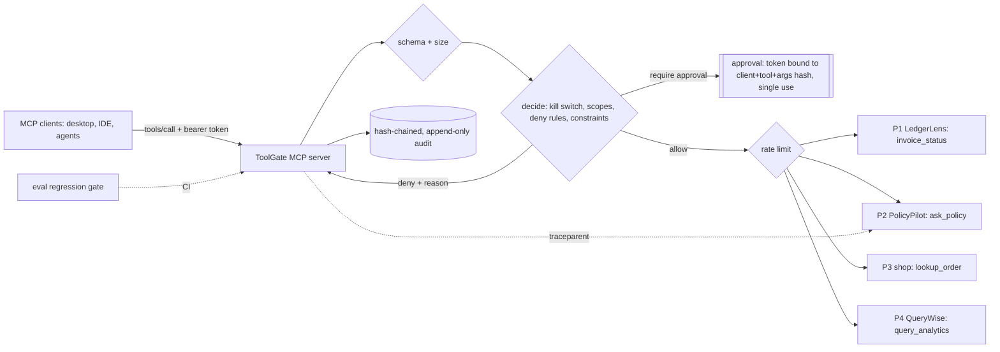

# ToolGate

**One governed door between AI agents and internal systems.** ToolGate is an MCP server that
exposes the other four portfolio services as curated tools, and decides on every call, from
the caller's token, whether it may run: deny by default, per-client scopes, argument
constraints, rate limits, human approval bound to the exact call, a kill switch, and a
tamper-evident audit trail. A second piece, the **eval regression gate**, fails CI when a
prompt or model change makes any of the projects worse.

**Live:** MCP endpoint `https://toolgate-a2or.onrender.com/mcp/` (streamable HTTP, bearer client
token; tokens on request), in front of the four live services. Checked live: allowed calls
reach P2, P3 and P4; out-of-scope calls are denied (`MISSING_SCOPE`, `DENY_RULE`); an
invoice lookup waits for approval; a bad token is refused; the audit hash chain verifies.
Free hosting: the first call after idling can take about a minute.

Project 5 of 5 from my 60-day FDE plan. Stack: official MCP Python SDK 2.3 (`MCPServer`,
streamable HTTP + stdio) · FastAPI · Postgres · OpenTelemetry · Prometheus. The right amount of
LLM in a gateway is none: everything here is deterministic.



## What it guarantees, and the evidence

| Requirement | How | Evidence |
|---|---|---|
| **F1** MCP compliance | 4 tools with JSON Schemas via the official SDK; streamable HTTP with bearer auth, stdio for desktop clients | `test_mcp_lists_four_tools_and_enforces_policy`; live run over HTTP: no token -> 401; `support-agent` gets a real order from P3, a scope denial for analytics, an `ARG_CONSTRAINT` for a bad order id ([scripts/mcp_e2e.py](scripts/mcp_e2e.py)) |
| **F2** Policy | `decide()` is a pure function over [policies.yaml](config/policies.yaml); deny wins over allow; unknown tool, missing scope, constraint violations all deny; invalid policy -> refuses to start | **29 table-driven cases** + 8 invalid-policy files ([test_policy_engine.py](tests/unit/test_policy_engine.py)); `decide()` takes ~15 µs |
| **F3** Approvals | `require_approval` returns `pending_approval`; an admin's token works **once**, only for the **same client + tool + args hash**, before expiry | `test_approval_token_works_once_and_only_for_same_call`: other args denied, replay denied, exactly one downstream call |
| **F4** Tamper evidence | Each audit row stores `sha256(prev_hash ‖ canonical_json(row))`, appended under an advisory lock (gapless); a trigger refuses UPDATE/DELETE/TRUNCATE | Edit row 3 with the trigger disabled -> `verify-audit` reports **seq 3**; delete row 2 -> reports seq 3 (dangling link) |
| **F5** Kill switch | Global or per tool, read on every call (cached ≤ 1 s; the admin endpoint invalidates locally) | `test_kill_switch_takes_effect_on_next_call_without_restart` |
| **F6** Regression gate | Reports from P1–P3 normalised to one schema, compared with baselines ± tolerance | **A real run with P2's older, weaker prompt fails the gate** (citation precision 0.985 -> 0.838, answer accuracy 0.921 -> 0.889); the released results pass |
| **N1** Overhead | Stubbed downstream, 500 calls | **p50 33 ms, p95 52 ms** on Windows + Docker Desktop, almost all Postgres round trips (~3 ms each, ~20 ms per session checkout); method and breakdown in [overhead.md](evals/reports/overhead.md) |
| **N2** Trace continuity | W3C `traceparent` injected into every downstream request | `test_downstream_request_carries_the_gateway_trace_id` (same trace id in the request and the audit row) |

Also: no unaudited actions (an audit write failure fails the call); downstream outages and
timeouts become structured tool errors, never hangs, never retried; client tokens and approval
tokens are stored as SHA-256 only; downstream outputs are size-capped and labelled as untrusted
data; `lookup_order` strips the customer's email and address before returning.

## The regression gate

```
$ python -m toolgate.regress --fixtures evals/fixtures \
    --use p2-policypilot-answers=evals/fixtures/degraded/p2-policypilot-answers.json
| p2-policypilot-answers | answer_accuracy    | 0.9206 | 0.8889 | -0.03171 | +/-0.03 | **REGRESSED** |
| p2-policypilot-answers | citation_precision | 0.9846 | 0.8375 | -0.1471  | +/-0.03 | **REGRESSED** |
**Gate: FAIL** (2 of 11 metrics regressed or missing)
```

The "degraded" input is not synthetic: it is PolicyPilot's recorded dev run with its first
prompt (`answer_v1`), which the second prompt replaced. Tolerances are about one standard
error of each metric at its suite size; safety counters (false auto-approvals, permission
leaks, unsafe actions) have zero tolerance. In CI ([regression.yml](.github/workflows/regression.yml))
pull requests run on recorded fixtures (no model calls, no cost) and the workflow also asserts
that the degraded run is caught. Live mode re-runs the deterministic suite (P3's rules
baseline); LLM suites are re-run by hand on the free tier with each project's `--max-cost`.
P4 joins once its ablation report exists.

## Run it

```powershell
docker compose up -d --wait db
uv sync; uv run alembic upgrade head
uv run python -m toolgate.cli check-policy
uv run python -m toolgate.cli create-client support-agent        # bearer token, printed once
uv run python -m app.cli create-key --name me --role admin        # admin API key
uv run uvicorn toolgate.main:create_app --factory --port 8009     # MCP at http://127.0.0.1:8009/mcp/
uv run python scripts/mcp_e2e.py <client-token>                   # or MCP Inspector / any MCP client
```

Desktop clients over stdio: set `STDIO_CLIENT_TOKEN` and run `python -m toolgate.cli stdio`.
Admin: `GET /admin/approvals`, `POST /admin/approvals/{id}` (returns the one-time token),
`POST /admin/kill-switch`, `GET /admin/audit/verify`, `GET /admin/dashboard` (calls, denies,
errors, pending, p95 and LLM cost per tool, chain status), `GET /metrics`.

## Design notes

- [ADR 0007: decide() is pure, approvals bind to the call, audit is a hash chain](docs/adr/0007-pure-policy-bound-approvals-hash-chain.md)
- [Threat model](docs/THREAT_MODEL.md) · [Deployment](docs/DEPLOYMENT.md) (live on Render free + Neon free)

**Limits, stated plainly:** OAuth 2.1 is documented, not built (static bearer tokens per
client); rate limits and caches are per process; the hash chain proves the log wasn't edited
after the fact but not that the database host is honest (anchoring the head hash externally
would); downstream services don't yet send `X-LLM-Cost-USD` (the gateway records it when they
do); a disabled or rotated token keeps working for up to 1 s (identity cache).
